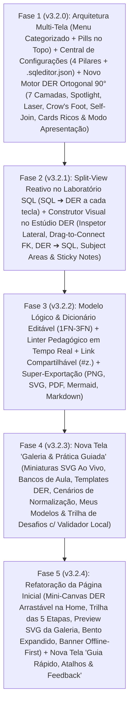

# Plano Mestre de Ação & Arquitetura: Central da Disciplina de Banco de Dados (`v3.2.0` → `v3.2.4`)

## 1. Visão Norteadora, Estética Autoral & Conformidade Legal

Este documento consolida o estudo arquitetural profundo dos projetos **`LiveSchema Studio`** (`analisar/LiveSchema-Studio-main`) e **`drawDB`** (`analisar/drawdb-main` — incluindo todas as suas páginas: `LandingPage.jsx`, `SimpleCanvas.jsx`, `Templates.jsx`, `Editor.jsx`, `StartModal.jsx`, `SettingsContext.jsx`, `BugReport.jsx` e `NotFound.jsx`) aliado às **9 decisões estruturais alinhadas via `/grill-me`** (Prompts 62–72).

### 🎯 Objetivo Norteador ("North Star")
Transformar o **`SQLEditor`** na **Central Definitiva para o Aluno Praticar Todas as Etapas da Disciplina de Banco de Dados** — desde o levantamento de requisitos/conceitual e normalização lógica (`1FN`–`3FN`), passando pela modelagem visual física (`DER ↔ SQL`), implementação `DDL/DML/Triggers` em tempo real, até consultas analíticas `DQL` e desafios práticos com validação local — **distribuindo cada etapa em módulos limpos sem sobrecarregar o `Editor (Workspace)`**.

### 🎨 Contrato Estrito de Preservação Estética (`SQLEditor Design Lock`)
1. **Zero Contaminação Visual Externa:** É terminantemente proibido importar `@douyinfe/semi-ui`, o tema azul-petróleo/cinza claro do `drawDB` (`#12495e`, `zinc-100`) ou o glassmorphism índigo/roxo do `LiveSchema` (`#6366f1`, `#0b0f17`).
2. **100% Identidade `SQLEditor` / `Milkfed Devs && Reqs Lords`:** Todos os novos componentes, páginas, miniaturas SVG, linhas de relacionamento, áreas temáticas e post-its utilizarão estritamente nossas variáveis CSS semânticas (`--bg-primary`, `--bg-secondary`, `--bg-surface`, `--bg-panel`, `--bg-hover`, `--border-color`, `--text-primary`, `--text-secondary`, `--text-muted`, `--schema-icon-color`), nossa paleta assinatura (**Laranja `#FF6B00` / `#FF8533`**, **Amarelo Solar `--accent-yellow: #FFE600`**, **Verde `#00E676`**, **Ciano `#29B6F6`**), tipografia `Inter` + `JetBrains Mono`, ícones `Material Symbols Outlined` e suporte nativo instantâneo à matriz **4 Temas de Interface (`Dark`, `Light`, `Bege`, `Grafite`) × 4 Temas de Sintaxe (`Solar`, `Cyber`, `Matrix`, `Synthwave`)**.

### 🛡️ Matriz de Reaproveitamento de Código & Blindagem Legal
1. **`LiveSchema Studio` (Mesma stack: React 19 + TS + Vite 8 + Tailwind v4 + Monaco):**
   - **Aproveitamento / Adaptação Direta:** Geometria determinística compartilhada (`engine/layout.ts` → `columnAnchorY`), pilha SVG interativa de 7 camadas (`RelationshipLines.tsx`, adaptada para a nossa **geometria Ortogonal 90° com Cantos Arredondados** e nossos tokens de cor), zoom focal no cursor (`InteractiveCanvas.tsx`), card com amostra viva e triggers (`FloatingTableCard.tsx`), parser SQL reativo tolerante com `useDeferredValue` (`engine/sqlParser.ts`) e link compartilhável `#z.` via `CompressionStream` (`lib/shareLink.ts`).
2. **`drawDB` (Licença GNU AGPLv3 — Copyleft Viral via Rede):**
   - **Proibição Absoluta de Cópia Literal:** Nenhum arquivo `.js`/`.jsx` de `drawdb-main` será copiado para o nosso projeto.
   - **Implementação 100% Clean-Room em TypeScript:** Todos os fluxos e conceitos inspirados nas páginas do `drawDB` (mini-canvas arrastável na Home, galeria de Templates com miniaturas SVG ao vivo, tutorial de templates customizados, Inspetor Lateral do Estúdio DER, Modo Apresentação Tela Cheia, Self-Join `"C"`, garfo composto `fork-trunk-fork`, Subject Areas, Sticky Notes, Drag-to-Connect FK, Linter e tela de Guia/Bug Report) serão escritos do zero em TypeScript estrito com a nossa estética.
3. **Isolamento no Git:** A pasta `analisar/` permanece bloqueada no `.gitignore` raiz e jamais será enviada ao repositório remoto.

---

## 2. Nova Arquitetura de Navegação, Menu e Telas da Central

Para evitar que o `Editor (Workspace)` vire um "canivete suíço poluído", cada etapa da disciplina ganha seu espaço dedicado, conectado por **Pills Rápidas de Módulo na Barra Superior (`Header.tsx`)** e por um **Menu Principal Categorizado (`MainMenuDropdown.tsx`)**:

```text
Navegação Superior Rápida (Pills no Header - configurável):
  [ 📚 Galeria & Prática ]  ➔  [ 📐 Modelo Lógico ]  ➔  [ 🕸️ Estúdio DER ]  ➔  [ 💻 Laboratório SQL ]

Menu Hambúrguer Categorizado (MainMenuDropdown.tsx):
  ├── 🎓 JORNADA DA DISCIPLINA (MÓDULOS PRÁTICOS)
  │    ├── Galeria & Prática Guiada      (#galeria)  [NOVA TELA - Templates, Bancos, Normalização & Desafios]
  │    ├── Modelo Lógico & Dicionário    (#modelo)   [EVOLUÇÃO ERModelView - MER Canônico, 1FN-3FN & Dicionário]
  │    ├── Estúdio DER Visual            (#der)      [EVOLUÇÃO ERDiagramView - Canvas Completo, Inspetor & Apresentação]
  │    └── Laboratório SQL (Workspace)   (#editor)   [WORKSPACE LIMPO - SQL DDL/DML/DQL + Toggle Split-View DER Ao Vivo]
  ├── 🛠️ FERRAMENTAS & PREFERÊNCIAS
  │    ├── Histórico de Execuções        (#historico)
  │    ├── Visualização Contextual       (Submenu dinâmico: painéis do Editor ou camadas do DER)
  │    └── Configurações & Temas         (#configuracoes) [EXPANDIDA EM 4 PILARES + Submenus rápidos Alt+T / Alt+L]
  └── 🏛️ VITRINE, APOIO & INSTITUCIONAL
       ├── Página Inicial (Vitrine)      (#landing)  [REFATORADA - Mini-Canvas Arrastável + Trilha da Disciplina]
       ├── Guia Rápido, Atalhos & Report (#guia)     [NOVA TELA - Tutorial visual, Mapa de Atalhos & Feedback GitHub]
       └── Sobre o Projeto               (#sobre)
```

### Mapa Completo de Módulos e Arquivos Planejados (`frontend/src/`)

```text
frontend/src/
├── types/
│   └── preferences.ts               # Contrato tipado AppPreferences (4 pilares) + tipos de Templates, Notas, Áreas e Desafios
├── services/
│   ├── preferencesStorage.ts        # Persistência reativa de preferências + exportação/importação de Super-Backup (.sqleditor.json)
│   ├── erLayoutEngine.ts            # Geometria determinística (columnAnchorY, rotas ortogonais 90° arredondadas, Self-Join "C", fork composto, auto-layout 16:9)
│   ├── liveSqlSchemaParser.ts       # Parser reativo a cada tecla (CREATE/ALTER TABLE, INSERT sample rows, CREATE TRIGGER)
│   ├── visualDdlGenerator.ts        # Engenharia Direta DER ➔ SQL (CREATE/ALTER TABLE, ADD FOREIGN KEY) cirúrgica via executeEdits
│   ├── schemaLinter.ts              # Linter pedagógico PT-BR (PK ausente, FK órfã, FK≠PK, ciclos DFS, anomalias 1FN-3FN, FK implícita vs explícita)
│   ├── schemaExporters.ts           # Exportadores: PNG HD, SVG Vetorial, PDF A4, Mermaid (erDiagram) e Dicionário Markdown (.md)
│   ├── shareSchemaLink.ts           # Link zero-backend #z.<deflate-base64url> via Web CompressionStream API
│   └── exerciseValidator.ts         # Motor local de autocorreção de exercícios/desafios (compara resultado DQL ou schema DDL esperado no AlaSQL)
├── data/
│   ├── erTemplatesCatalog.ts        # Templates DER didáticos + cenários conceituais e desafios de Normalização (1FN -> 2FN -> 3FN)
│   └── practiceExercisesCatalog.ts  # Trilha graduada de exercícios práticos vinculados aos bancos de aula (db_rh, db_ecommerce, pizzaria, etc.)
└── components/
    ├── Header.tsx                   # Atualizado com Pills Rápidas das Etapas da Disciplina + ações contextuais por tela ativa
    ├── MainMenuDropdown.tsx         # Reorganizado nas 3 categorias semânticas (Jornada da Disciplina, Ferramentas, Apoio/Institucional)
    ├── SettingsView.tsx             # Expandido nos 4 Pilares (Aparência/Lab, Editor SQL, Estúdio DER, Pedagogia & Super-Backup .sqleditor.json)
    ├── LandingPageView.tsx          # Refatorado: Mini-Canvas DER Arrastável real, Trilha das 5 Etapas, Vitrine SVG da Galeria, Bento 12 cards, Banner Offline-First + 100% Milkfed/Prof. William/Changelog
    ├── GalleryAndPracticeView.tsx   # [NOVA TELA] Inspirada em /templates do DrawDB: Bancos de Aula, Templates DER, Desafios c/ Validador e Meus Modelos Salvos
    ├── GuideAndFeedbackView.tsx     # [NOVA TELA] Inspirada em /bug-report + NotFound: Guia visual rápido, Atalhos completos e Gerador de Issue/Feedback
    ├── ERModelView.tsx              # Evoluído para "Modelo Lógico & Dicionário": comentários editáveis por coluna, checklist 1FN-3FN e exportação Dicionário
    └── er/
        ├── ERStudioWorkspace.tsx    # Orquestrador do Estúdio DER (Tela Dedicada c/ Inspetor Lateral + Modo Apresentação OU Split-View compacto no Editor)
        ├── ERInteractiveCanvas.tsx  # Pan/Zoom focal no cursor (Ctrl+Scroll), Snap-to-Grid 24px, busca rápida de tabela
        ├── ERRelationshipLayer.tsx  # 7 camadas SVG: Ortogonal 90° arredondada, z-[5]➔z-30, Spotlight 22%, Laser FK➔PK, Crow's Foot / 1:N / Pinos, distinção FK explícita vs inferida
        ├── ERTableCard.tsx          # Card rico: Estrutura vs 👁️ Dados, ⚡ Triggers, Colapso PK/FK, Faixa de cor, Trava 🔒, Portas Drag-to-Connect FK
        ├── ERSubjectAreasLayer.tsx  # Áreas Temáticas com transporte solidário de tabelas e colapso de módulo
        ├── ERStickyNotesLayer.tsx   # Notas de Requisitos / Post-its com canto dobrado SVG
        ├── ERInspectorSidebar.tsx   # Inspetor lateral retrátil (apenas na tela Estúdio DER): abas Tabelas, Relacionamentos, Áreas, Notas e Saúde/Linter
        ├── ERCanvasToolbar.tsx      # Barra flutuante + Controles de Modo Apresentação Tela Cheia (inspirado em FloatingControls)
        ├── ERThumbnailSvg.tsx       # Miniatura vetorial SVG ao vivo nos 4 temas (para a Galeria & Prática e para a Landing Page)
        └── HeroInteractiveERCanvas.tsx # Mini-Canvas DER real e arrastável a 60fps para o Hero/Showcase da Landing Page
```

---

## 3. Especificação Detalhada dos Novos Subsistemas

### 3.1. Central de Configurações em 4 Pilares (`SettingsView.tsx` + `AppPreferences`)
Todas as configurações persistem localmente e refletem-se imediatamente nas toolbars contextuais:
1. **Pilar 1 — Aparência, Acessibilidade & Laboratório:**
   - Matriz **4 Temas de Cor × 4 Temas de Sintaxe** (`Alt+T` / `Alt+L`);
   - Tamanho da fonte do código (`12px–22px`) e Zoom inicial padrão do DER (`75%–150%`);
   - Exibir/ocultar barra de **Pills Rápidas de Módulos** no cabeçalho;
   - **Modo Leve para Laboratório (`reducedMotionAndGlow`):** desativa filtros `feGaussianBlur` pesados e animações contínuas para rodar liso em computadores escolares modestos.
2. **Pilar 2 — Laboratório SQL & Assistência de Código:**
   - Toggle `autoUppercaseKeywords` (auto-capitalização `select → SELECT` em tempo real);
   - Toggle `autoInsertSemicolon` (inserção inteligente de `;` ao iniciar novo comando principal);
   - Toggle `syncDatabaseWithCursorUse` (sincronizar banco ativo ao mover o cursor entre blocos `USE`);
   - Seletor `defaultDataPreviewLimit` (`Limit 30` / `Limit 100` / `Total`);
   - Proporção inicial do Split-View (`50/50`, `60/40`) e toggles de confirmação (`Limpar Script`, `Fechar Todas as Abas`).
3. **Pilar 3 — Estúdio DER & Diagramação:**
   - `lineStyle`: **`Ortogonal 90° Arredondada (Padrão SQLEditor)`** ou `Curva Bézier Suave`;
   - `cardinalityNotation`: **`Pé-de-Galinha (Crow's Foot)`**, **`Clássica (1:N)`** ou **`Pinos Modernos + Seta`**;
   - `labelVisibility`: **`Sob demanda no foco/hover (Canvas Limpo)`** ou `Sempre visíveis`;
   - `animateLaserFlow`: fluxo laser direcional `FK ➔ PK` (`ON/OFF`);
   - `gridMode` (`Pontilhada`, `Linhas`, `Oculta`) + `snapToGrid` (`24px`);
   - **Toggle Pedagógico `inferImplicitForeignKeys`:** quando ativo, desenha FKs inferidas por nome (`id_cliente`, `cliente_id`) com **traço sutilmente diferenciado e badge `[Inferida]`**, ensinando ao aluno a diferença entre apenas nomear uma coluna e declarar `FOREIGN KEY` de verdade! Quando desativado (ex: em provas de DDL), exibe **estritamente** `FOREIGN KEY`s declaradas no SQL.
4. **Pilar 4 — Pedagogia, Linter & Super-Backup Portátil (`.sqleditor.json`):**
   - `linterStrictness`: **`Estrito Acadêmico`** (cobra PK, integridade de tipos `FK = PK`, alertas de 1FN/2FN/3FN e FKs não declaradas) vs **`Flexível`** (apenas erros estruturais críticos);
   - **Super-Backup Portátil do Aluno (`.sqleditor.json`):** exporta e restaura em um único arquivo todos os bancos locais, abas de scripts, diagramas DER salvos, posições, áreas temáticas, notas adesivas, comentários do dicionário de dados, progresso nos desafios e preferências — ideal para o aluno salvar ao fim da aula no laboratório e importar em casa!

### 3.2. Nova Tela `Galeria & Prática Guiada` (`GalleryAndPracticeView.tsx`)
Inspirada na arquitetura de `/templates` (`Templates.jsx` + `Thumbnail.jsx`) do `drawDB`, expandida para o ensino completo de BD e 100% estilizada com nossos tokens:
- **Miniaturas Vetoriais Ao Vivo (`ERThumbnailSvg.tsx`):** Renderiza a silhueta real das tabelas, faixas coloridas, linhas ortogonais 90° e áreas temáticas de cada banco/template adaptada automaticamente ao tema ativo (`Dark`, `Light`, `Bege`, `Grafite`).
- **4 Guias Organizadas por Objetivo Pedagógico:**
  1. **Bancos de Aula & Presets (`Modo Aula`):** Cards ricos para `db_rh`, `db_streamflix`, `db_pizzaria_express`, `db_escolaidiomas`, `db_ecommerce`, `ecommerce_db` e `universidade_db` com ações de 1 clique: *"Consultar no SQL"*, *"Abrir no Estúdio DER"* ou *"Inspecionar Dicionário"*.
  2. **Templates de Modelagem & Normalização (`1FN`–`3FN`):** Arquiteturas prontas para clonar (*Fork*) + **Cenários Desnormalizados de Sala de Aula** (ex: *Planilha de Pedidos com Colunas Repetidas — Violação de 1FN*, *Dependência Parcial em Chave Composta — Violação de 2FN*, *Dependência Transitiva — Violação de 3FN*) onde o aluno clona o modelo para normalizar no Estúdio DER/SQL com auxílio do Linter!
  3. **Trilha de Exercícios & Desafios Autocorrigíveis:** Lista filtrável por banco e etapa (*Conceitual/DDL*, *DML*, *Consultas Básicas*, *JOINs*, *Agregações `GROUP BY`*, *Subqueries*). Clicar em *"Praticar Desafio"* abre um banner compacto de enunciado no topo do Laboratório SQL/DER com o botão **"Validar Minha Solução"** (`exerciseValidator.ts` compara localmente o conjunto de colunas/registros ou tabelas/constraints geradas com o gabarito esperado, exibindo feedback construtivo em PT-BR e marcando o desafio como concluído `✓` no `IndexedDB`).
  4. **Meus Modelos & Diagramas Salvos:** Galeria pessoal do aluno (`Salvar como Modelo` a partir do Estúdio DER), com guia visual passo-a-passo em 3 etapas quando vazia.

### 3.3. Refatoração da Página Inicial (`LandingPageView.tsx`) & Tela `Guia Rápido & Feedback`
Baseada na dissecação completa de `LandingPage.jsx`, `SimpleCanvas.jsx`, `BugReport.jsx` e `NotFound.jsx` do `drawDB`, preservando 100% da nossa assinatura visual:
1. **Mini-Canvas DER Interativo Real na Home (`HeroInteractiveERCanvas.tsx`):** O visitante arrasta livremente os cards de tabelas (`tb_pedidos`, `tb_clientes`, `tb_itens_pedido`, `tb_produtos`) direto na Landing Page e vê nossas **linhas Ortogonais 90° Arredondadas**, inversão automática de borda, Spotlight `22%` e fluxo laser `#FFE600`/`#FF6B00` recalculando a 60fps!
2. **Vitrine Multi-Abas Evoluída:** Alterna entre *1) Estúdio DER Arrastável Ao Vivo*, *2) Split-View Reativo `SQL ↔ DER`*, *3) Grade de Dados (`Limit 30/100/Total`)* e *4) Modelo Lógico, Dicionário & Linter*.
3. **Seção Interativa "Trilha das 5 Etapas da Disciplina de Banco de Dados":** Linha do tempo horizontal/vertical clicável onde cada etapa explica o conceito acadêmico e abre a ferramenta correspondente da Central.
4. **Preview da Galeria com Miniaturas SVG Clonáveis + Bento Grid de 12 Recursos + Banner Educativo Offline-First:** Apresenta os bancos e templates com `<ERThumbnailSvg />` real e inclui o aviso educativo de persistência local no navegador com atalho direto para o Super-Backup.
5. **Preservação Integral das Seções Autorais:** Seção **Milkfed Devs && Reqs Lords** (com modal de zoom da logo), perfil completo do **Professor William Devidé Komel**, **Changelog Expansível** e **Quickstart Terminal** permanecem intactos.
6. **Nova Tela `Guia Rápido, Atalhos & Reportar Feedback` (`GuideAndFeedbackView.tsx`):** Reúne cards visuais de dicas rápidas (*como arrastar pino FK, usar Split-View, executar linha no cursor `Alt+E`, inspecionar pills `#1/#2`*), tabela completa de atalhos de teclado e formulário estruturado de Feedback/Bug Report que monta o diagnóstico técnico automaticamente para abertura em 1 clique no GitHub Issues (ou cópia formatada).

---

## 4. Roadmap de Implementação em 5 Fases Incrementais (`v3.2.0` → `v3.2.4`)

Cada fase constitui uma entrega autocontida, testável e sem regressões (com `npm run lint`, `npm run build` e suíte automatizada determinística na Fase X de cada etapa):



### Detalhamento de Tarefas (`INPUT → OUTPUT → VERIFY`) por Fase

#### 🟢 Fase 1 (`v3.2.0`) — Navegação da Central, Configurações 4 Pilares & Motor DER Ortogonal 90° Core
- **Agentes & Skills:** `@frontend-specialist` + `@database-architect` (`@frontend-architecture`, `@clean-code`, `@tailwind-patterns`).
- **Tarefas:**
  1. **`preferences.ts` + `preferencesStorage.ts` + `SettingsView.tsx`:** Implementar estado global `AppPreferences` com os 4 pilares (incluindo toggles do Editor SQL como auto-MAIÚSCULAS, auto `;`, sync de `USE`, limite padrão, toggles do DER como `inferImplicitForeignKeys`, e Super-Backup `.sqleditor.json`).
  2. **`Header.tsx` + `MainMenuDropdown.tsx` + `App.tsx`:** Reorganizar menu nas 3 categorias da Central, adicionar Pills rápidas de módulos no topo e rotas hash sincronizadas.
  3. **`erLayoutEngine.ts` + `ERRelationshipLayer.tsx` + `ERTableCard.tsx` + `ERInteractiveCanvas.tsx` + `ERCanvasToolbar.tsx`:** Novo motor DER mantendo nossas linhas **Ortogonais 90° Arredondadas** com as 7 camadas do LiveSchema (`z-[5]→z-30`, Spotlight `22%`, laser `FK➔PK`, pílulas sob demanda, Self-Join `"C"`, garfo composto, seletor `Crow's Foot`/`1:N`/`Pinos`, distinção visual FK explícita vs inferida), Cards Ricos (`👁️ Dados`, `⚡ Triggers`, Colapso `PK/FK`, Faixa de cor, Trava `🔒`), Zoom focal no cursor, Snap-to-Grid `24px` e **Modo Apresentação Tela Cheia**.
- **VERIFY:** Suíte unitária de geometria/rotas 90°/preferências/backup `.sqleditor.json` + validação nos 4 temas × 4 sintaxes + `npm run lint` & `npm run build` (`0` erros).

#### 🔵 Fase 2 (`v3.2.1`) — Split-View Reativo (`SQL ↔ DER`) & Bancada Visual Completa no Estúdio DER
- **Agentes & Skills:** `@frontend-specialist` (`@frontend-architecture`, `@nextjs-react-expert`, `@clean-code`).
- **Tarefas:**
  1. **`liveSqlSchemaParser.ts` + `ERStudioWorkspace.tsx`:** Parser reativo tolerante (`useDeferredValue`) para `CREATE/ALTER TABLE`, `INSERT` e `TRIGGER`, habilitando o botão limpo de **Split-View (`Editor | DER Ao Vivo`)** no Laboratório SQL e a Fonte Dupla (`Banco Ativo` ↔ `Script Ao Vivo`).
  2. **`ERInspectorSidebar.tsx` + `visualDdlGenerator.ts`:** Inspetor lateral dedicado exclusivamente à tela **Estúdio DER Visual** (*Tabelas, Relacionamentos, Áreas, Notas*), `+ Nova Tabela`, edição visual de colunas e `Drag-to-Connect FK` gerando DDL cirúrgico no Monaco (`executeEdits` com `Ctrl+Z` preservado).
  3. **`ERSubjectAreasLayer.tsx` + `ERStickyNotesLayer.tsx`:** Áreas Temáticas com transporte solidário de tabelas e Notas de Requisitos com canto dobrado SVG.
- **VERIFY:** Benchmark de parsing ao vivo (<10ms) + testes automatizados de round-trip `Visual Action ➔ DDL SQL ➔ Parser` sem perda de comandos adjacentes.

#### 🟣 Fase 3 (`v3.2.2`) — Modelo Lógico, Dicionário de Dados, Normalização, Linter & Super-Exportação
- **Agentes & Skills:** `@database-architect` + `@frontend-specialist` (`@database-design`, `@clean-code`).
- **Tarefas:**
  1. **`ERModelView.tsx` Evoluído:** Transformar em **Modelo Lógico & Dicionário de Dados**, com descrições/comentários editáveis por tabela/coluna persistidos localmente, guia interativo de verificação `1FN / 2FN / 3FN` e visão formal canônica.
  2. **`schemaLinter.ts` + Aba Saúde no Inspetor/Drawer:** Diagnóstico pedagógico em PT-BR (PK ausente, FK órfã, tipo `FK ≠ PK`, ciclos DFS, alertas de normalização e aviso de FKs apenas implícitas por nome).
  3. **`shareSchemaLink.ts` + `schemaExporters.ts`:** Compartilhamento zero-backend via URL `#z.` (`CompressionStream` abrindo em nova aba segura) + exportadores `PNG HD`, `SVG Vetorial`, `PDF A4`, `Mermaid (erDiagram)` e `Dicionário Markdown (.md)`.
- **VERIFY:** Testes unitários de todas as regras do Linter, round-trip de compressão `#z.` e validação estrutural dos arquivos SVG, Mermaid e Markdown gerados.

#### 🟠 Fase 4 (`v3.2.3`) — Nova Tela `Galeria & Prática Guiada` (Templates SVG + Desafios Autocorrigíveis)
- **Agentes & Skills:** `@frontend-specialist` + `@database-architect` (`@frontend-design`, `@database-design`, `@testing-patterns`).
- **Tarefas:**
  1. **`ERThumbnailSvg.tsx` + `erTemplatesCatalog.ts`:** Motor leve de miniaturas vetoriais SVG adaptadas aos 4 temas + catálogo de Templates DER clássicos e Cenários de Normalização (`1FN`→`3FN`).
  2. **`practiceExercisesCatalog.ts` + `exerciseValidator.ts`:** Catálogo estruturado de desafios práticos de DDL, DML e DQL sobre os bancos de aula + motor local de validação de gabarito (executa e compara resultado/schema sem servidor externo, salvando conquistas no `Dexie`).
  3. **`GalleryAndPracticeView.tsx`:** Construção da nova tela com as 4 guias (*Bancos de Aula*, *Templates & Normalização*, *Desafios Práticos*, *Meus Modelos Salvos*) e barra de enunciado ativo acoplável ao Laboratório SQL/Estúdio DER.
- **VERIFY:** Testes automatizados validando gabaritos positivos/negativos de todos os exercícios do catálogo + clonagem (*Fork*) de templates e salvamento de modelos customizados no `Dexie`.

#### 🔴 Fase 5 (`v3.2.4`) — Refatoração da `LandingPageView` & Nova Tela `Guia Rápido, Atalhos & Feedback`
- **Agentes & Skills:** `@frontend-specialist` (`@frontend-design`, `@web-design-guidelines`, `@clean-code`).
- **Tarefas:**
  1. **`HeroInteractiveERCanvas.tsx` + `LandingPageView.tsx`:** Implementar o Mini-Canvas DER real e arrastável a 60fps na Home (com nossas linhas 90° arredondadas + laser `#FF6B00`/`#FFE600`), seção interativa *"Trilha das 5 Etapas da Disciplina"*, vitrine da Galeria com `<ERThumbnailSvg />` clonável em 1 clique, Bento Grid de 12 recursos e Banner Educativo Offline-First, mantendo 100% da nossa estética e das seções *Milkfed Devs && Reqs Lords*, *Prof. William Devidé Komel*, *Changelog* e *Terminal Quickstart*.
  2. **`GuideAndFeedbackView.tsx`:** Criar a tela leve de Guia Rápido Visual, Mapa Completo de Atalhos e Reporte Estruturado de Feedback/Bugs integrado ao GitHub.
  3. **Fase X Global:** Auditoria completa de contraste/UX nos 4 temas × 4 sintaxes, zero referências estéticas ou de código AGPLv3 externas, atualização do `README.md` bilíngue e validação final `lint` + `build` + E2E.
- **VERIFY:** `npm run lint`, `npm run build`, verificação de 60fps no arraste do Hero Canvas e inspeção visual completa nos temas `Dark`, `Light`, `Bege` e `Grafite`.
